# Xphire: application-pipeline architecture plan

## Goal and boundary

Extend Xphire from a job-discovery and email-digest tool into a **job-to-application workbench**. It should identify real, currently open roles that fit one candidate, prepare a factual tailored resume, help submit applications, track them, and flag positive recruiter emails.

The core workflow should be deterministic and auditable. LLMs are not required for discovery, eligibility checks, ranking, resume selection, PDF generation, application tracking, or email classification. A human must approve each application before it is sent. Job-board access must use permitted feeds/APIs and normal application flows: no CAPTCHA bypass, fake activity, or unattended bulk submission.

“Concrete job” means a deduplicated requisition on an employer's career site (or a recognized ATS board) with a direct apply URL, employer, title, location, posting/verification timestamps, and an open-status check. A search result alone is not an application target.

## What Xphire already provides

- A React/TypeScript frontend, Supabase authentication, and a public job board.
- Python workers for scheduled scraping and email digests.
- Greenhouse, Lever, Ashby, and SmartRecruiters endpoint collectors, plus JobSpy-based sources.
- A Supabase `Seen_job` deduplication/catalog path and GitHub Actions schedules.
- An optional Gemini enrichment module. The current email/scrape flow invokes it for job enrichment.

This is a useful discovery foundation, not yet an application system. The current collector is India-oriented, and its `Seen_job` catalog is publicly readable. It does not have a candidate evidence/profile model, per-user job matching, tailored resume artifacts, application records, or inbox outcome tracking. Keep public job data separate from private candidate and application data. Do not put a resume, email content, or application answers in `Seen_job`.

## Proposed structure

1. **Candidate profile and evidence ledger**
   - Store verified experience, education, skills, dates, location/work authorization, preferences, and compensation bounds.
   - Each resume claim must link to candidate-provided evidence: an existing resume bullet, project, credential, or confirmed answer. Mark each fact as verified/unverified and retain provenance.
   - This is the only source for resume content and application answers; never infer qualifications from a JD.

2. **Job ingestion and verification**
   - Reuse and modularize the existing ATS collectors. Prefer employer/ATS public APIs and approved feeds; add sources only after checking their terms and access method.
   - Normalize postings to one schema; deduplicate by canonical apply URL plus employer/requisition ID, rather than relying only on title/company text.
   - Periodically recheck the employer page/API. Mark a role closed or stale if the requisition disappears, the apply URL fails, or it exceeds a configurable freshness window. Retain source and verification timestamps.

3. **Eligibility and matching (rules first)**
   - Apply hard filters first: role family, location/remote eligibility, experience level, work authorization, employment type, salary floor if specified, and open status. A failed mandatory condition excludes a role; unknown is shown as unknown, not treated as a match.
   - Normalize skill synonyms through a versioned taxonomy (e.g., `PostgreSQL`/`Postgres`) and extract JD terms with deterministic tokenization/phrase matching. Score eligible jobs using configurable weights for required-skill evidence coverage, seniority, location, preferred skills, and freshness. Show the matched/missing terms and score breakdown; don't use opaque company stars as candidate-fit scores.
   - Rank with a transparent weighted score and use explicit minimum thresholds. Keep false-positive reasons and allow the candidate to tune preferences.

4. **Resume tailoring and PDF generation**
   - Keep a master resume/profile plus a library of candidate-approved bullet variants, each linked to evidence and skills.
   - A deterministic selector chooses and reorders only supported bullets for each JD; it may adjust section ordering and truthful phrasing, but cannot create new facts, inflate metrics, or claim a missing skill.
   - Render a versioned LaTeX template from structured data (e.g., Jinja2), then compile using Tectonic or TeX Live in a controlled worker. Save the source, generated PDF, template version, job ID, and file hash. Local/self-hosted compilation is the default; Overleaf can remain a manual editing option, not a required API dependency.
   - Validate that the PDF compiles, has selectable text, fits the configured page limit, and contains no unsupported claim before it reaches the approval screen.

5. **Skill-gap and GitHub workflow**
   - Distinguish “not mentioned on resume” from “candidate does not have this skill.” First ask the candidate to confirm whether the skill is already supported by real experience.
   - If evidence exists but is omitted, propose a resume edit and let the candidate approve it. If the skill is genuinely missing, do not add it to the resume or fabricate GitHub evidence. Optionally create a GitHub issue with a suggested, clearly labeled practice-project plan; only create a branch/PR or publish code after explicit candidate approval. Never auto-push generated work or represent a tutorial project as employment experience.
   - Use a GitHub App/OAuth with least-privilege repository permissions. Record the linked repo, consent, action, and resulting URL in the audit log.

6. **Application assistant and tracker**
   - Queue only jobs that pass eligibility and have a verified apply URL. Display the JD, match explanation, missing requirements, selected resume PDF, and any application answers for review.
   - Candidate explicitly approves the final payload and submission. Start with opening the employer's application page and helping the candidate fill known fields; submit only where the site's terms and supported form flow allow it. Keep a manual fallback for CAPTCHAs, account creation, custom questions, and unsupported ATS forms.
   - Record each state transition (e.g., `matched`, `review_needed`, `approved`, `submitted`, `withdrawn`, `closed`, `rejected`, `interview`, `offer`) with timestamps and source. Never mark a job submitted merely because a PDF was generated or an apply page was opened.

7. **Email outcome monitor**
   - Add optional Gmail API read-only OAuth (or a user-configured IMAP connector) to scan application-related messages. Keep tokens encrypted and revokeable; request the narrowest scopes possible.
   - Match messages by sender/domain, employer, requisition, and application date. Use deterministic rules for explicit interview, assessment, recruiter-contact, rejection, and offer phrases. Classify uncertain messages as `needs_review`; a positive response should be marked only when there is an explicit invitation/next step, not merely an automated receipt.
   - Store message metadata/snippet and classification rationale, not full message bodies by default. Provide a dashboard notification and a user-editable status.

## Diagram

```mermaid
flowchart LR
    Sources[Employer career pages / permitted ATS APIs] --> Ingest[Job ingestion + normalization]
    Ingest --> Verify[Deduplicate + verify open status]
    Verify --> Catalog[(Shared public job catalog)]

    Profile[Candidate profile + evidence ledger] --> Match[Hard eligibility filters + explainable rules score]
    Catalog --> Match
    Match --> Queue[Private matched-job queue]
    Queue --> Tailor[Evidence-only resume selector]
    Profile --> Tailor
    Tailor --> Tex[LaTeX template + Tectonic/TeX Live]
    Tex --> Artifact[(Private resume artifacts + hashes)]

    Queue --> Review[Candidate review / approve]
    Artifact --> Review
    Review --> Apply[Application assistant / permitted submission]
    Apply --> Track[(Private application tracker + audit events)]

    GitHub[GitHub OAuth/App: opt-in] <--> Gap[Skill-gap review: confirm evidence or draft project issue]
    Match --> Gap
    Profile --> Gap

    Inbox[Gmail read-only / IMAP, opt-in] --> Classify[Rules-based email matcher]
    Track --> Classify
    Classify --> Track
    Track --> UI[Dashboard: jobs, applications, positive replies]
    Queue --> UI
```

## Application/data boundaries

Keep Xphire's existing public job catalog separate from these private, user-owned records. Add row-level security and test it for cross-user leakage before enabling the workflow.

| Record | Main purpose / important fields |
|---|---|
| `candidate_profiles` | User preferences, location, work authorization and profile version |
| `candidate_facts` | Structured verified facts, provenance, evidence reference, verification state |
| `skill_taxonomy` | Canonical skill, aliases, version |
| `jobs` (evolve shared catalog) | Employer, requisition, canonical URL, source, JD, locations, posted/checked/closed timestamps |
| `job_match_results` | User/job, eligibility decision, score, matched/missing terms, reason codes |
| `resume_artifacts` | User/job, source profile version, LaTeX, private PDF location, hash, template version, approval state |
| `applications` | User/job, state, submitted timestamp, resume artifact, confirmation/reference ID |
| `application_events` | Append-only status, email and manual-review events with source/rationale |
| `github_gap_tasks` | Skill gap, candidate decision, issue/PR link, consent and status |
| `email_connections` | Encrypted OAuth/token reference, provider, scopes and connection state |
| `audit_events` | Consent, approvals, generated artifacts and externally visible actions |

Use private object storage for resumes with short-lived download URLs. Encrypt OAuth credentials, keep service keys server-side, and make account deletion remove private records/artifacts and revoke integrations. Do not expose private tables via the public job-board policy.

## Suggested implementation sequence

1. **Foundation:** Add the private schema/RLS, migrations, audit events, candidate evidence editor, and a safe import path for the master resume. Keep current discovery running.
2. **Concrete job catalog:** Normalize IDs/URLs, add direct-link and freshness checks, employer status, location/experience extraction, and a close/stale lifecycle. Display source and verification time.
3. **Explainable matching:** Add deterministic hard filters and score explanations; test with curated real JDs and candidate-confirmed profile data. Do not introduce an LLM dependency.
4. **Resume artifacts:** Build the evidence-linked bullet library, LaTeX renderer/compiler, artifact storage and approval UI. Reject unsupported claims; retain artifact provenance.
5. **Application tracker:** Add review/approval, user-driven submission assistance, status history, duplicate-application prevention, and manual entry for submissions made outside Xphire.
6. **Positive-email monitoring:** Add opt-in read-only mail integration, deterministic classification, uncertain-message review and notification.
7. **GitHub gap tasks:** Add least-privilege GitHub integration only after the evidence and approval flows work. Start with user-approved issue creation; no automatic commits.
8. **Scale/hardening:** Add a durable queue, retries, rate limits, observability, data-retention controls, connector-specific compliance checks, and end-to-end privacy tests. Keep LLM enrichment optional and isolated; it must not make eligibility or application decisions.

For the first release, keep the current React + Supabase + Python shape. GitHub Actions can run periodic ingestion and small batch workers as it does today, but use a durable queue/worker service when jobs or per-user workflows outgrow scheduled Actions. Avoid parallel worker code changing process-global environment variables for user-specific applications; pass explicit user/job context.

## Cost estimate for 1,000 applications

Planning estimate in **USD**, assuming one candidate, 1,000 submitted applications total (not 1,000 job scans), an existing GitHub account, permitted free/public job sources, a local or already available machine, and **no paid LLM calls**. Vendor prices, free-tier quotas, job-source availability, and local tax vary; this is not a vendor quote.

| Cost item | Estimated cash cost for a 1,000-application batch | Assumptions |
|---|---:|---|
| Job discovery / ATS endpoints | $0 | Public endpoints/feeds used within their terms; no paid job-data subscription |
| Matching and resume tailoring | $0 | Deterministic local/Python processing |
| LaTeX-to-PDF | $0 | Tectonic/TeX Live run locally or on existing compute; no Overleaf plan/API assumed |
| GitHub integration | $0 | GitHub API/App within normal free usage; no paid service required |
| Email status monitoring | $0 | Existing Gmail account with read-only API access or existing IMAP provider; no paid outbound email service |
| Supabase / hosting / compute | $0–$30 for the batch | Can be $0 on existing/free resources for a low-volume prototype; allow roughly $25/month for a paid database tier plus small compute if private storage/production reliability needs it. This is a one-month planning allowance, not a guaranteed price. |
| Resume/object storage and logs | $0–$5 | Small PDFs/logs, existing/free storage, limited retention |
| Optional LLM use | $0 in the baseline | Not needed for core flow. If later enabled for optional text suggestions, set an explicit provider spend cap and price it against current provider rates first. |
| **Estimated software cash total** | **$0–$40** | Excludes any paid job board/data subscription, new domain, and existing computer/network costs. |

The largest cost is human review and form completion, not compute. At an average **4–8 minutes per application** to inspect the match, review the resume/answers, and handle the employer form, 1,000 applications take about **67–133 hours**. At a hypothetical $25/hour value for that time, the opportunity cost is **$1,675–$3,325**; this is not a cash fee. Some ATS applications take much longer. Automating submissions aggressively to avoid this time is not recommended: it raises quality, account, duplicate-submission, and terms-of-service risks. A better product target is to surface a small number of high-fit, verified roles daily and make each review/submission fast.

These estimates do not guarantee that 1,000 suitable, genuinely open jobs exist for the candidate or that any given ATS allows automated form submission.

## MVP acceptance checks

- Every recommended job has a direct employer/ATS apply URL, source, and last-verified time; closed/stale roles are suppressed.
- Each match shows hard-filter outcomes, score breakdown, evidence-backed matches, and unknown/missing requirements.
- Every generated resume claim is linked to a candidate-approved fact; no job description alone can create a candidate claim.
- A PDF is versioned and downloadable privately before submission; user approval is recorded.
- An application is tracked only after a submission confirmation or explicit manual confirmation; duplicates are blocked or warned.
- Positive messages have a visible classification reason; uncertain emails never silently become positive.
- GitHub changes require explicit, scoped consent and are never used as proof of a skill until the candidate confirms and the work is real.
- Row-level security tests prove one user cannot read another user's profile, resumes, applications, email metadata, or GitHub tasks.
